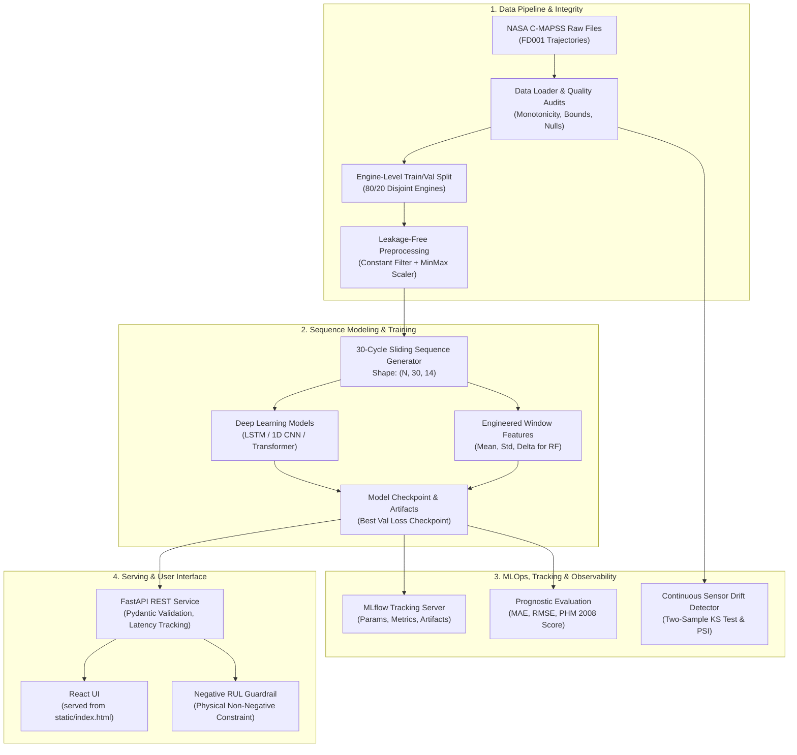

# DeepPredict: Advanced Turbofan Predictive Maintenance


**DeepPredict** is a production-grade, end-to-end predictive maintenance system engineered to forecast the **Remaining Useful Life (RUL)** of commercial aircraft turbofan engines using multivariate sensor degradation data from the **NASA Commercial Modular Aero-Propulsion System Simulation (C-MAPSS)** dataset.

---

## 1. System Architecture



---

## 2. Problem Statement & Dataset Overview

Turbofan engines undergo severe thermodynamic stress and mechanical wear during operational flight cycles. Accurate prognosis of **Remaining Useful Life (RUL)** prevents catastrophic in-flight failures while avoiding costly premature engine removals.

### NASA C-MAPSS FD001 Characteristics
- **Fleet**: 100 run-to-failure training engines, 100 test engines.
- **Flight Conditions**: Sea Level (single operational regime).
- **Failure Mode**: High-Pressure Compressor (HPC) degradation.
- **Features**: 3 operational settings + 21 sensor channels (temperatures, pressures, spool speeds, bleed flows).
- **Target Engineering**: Piecewise linear degradation model capped at **125 cycles** to reflect early-life steady state prior to micro-crack propagation.

---

## 3. Asymmetric Prognostics Scoring (PHM 2008)

Standard regression metrics (MAE, RMSE) penalize positive and negative errors symmetrically. In aviation prognostics:
- **Late Predictions ($\hat{y} > y$)**: The model overestimates engine life, risking catastrophic failure in flight.
- **Early Predictions ($\hat{y} < y$)**: The model predicts failure early, causing premature maintenance but preserving passenger safety.

The **PHM 2008 Prognostics Metric** formally enforces this asymmetric risk:

$$d_i = \hat{y}_i - y_i$$

$$s_i = \begin{cases} \exp\left(-\frac{d_i}{13}\right) - 1 & \text{if } d_i < 0 \text{ (Early)} \\ \exp\left(\frac{d_i}{10}\right) - 1 & \text{if } d_i \ge 0 \text{ (Late)} \end{cases}$$

$$\text{Total Score } S = \sum_{i=1}^{N} s_i$$

---

## 4. Quickstart & Installation (Windows PowerShell)

### Prerequisites
- Python 3.12 (accessible via `py -3.12` or virtual environment)

### Environment Setup
```powershell
# Navigate to project root
cd C:\Users\Vinay\DeepPredict

# Activate existing virtual environment
.\.venv\Scripts\Activate.ps1

# Install CPU-optimized PyTorch and all dependencies
pip install torch --index-url https://download.pytorch.org/whl/cpu
pip install -r requirements.txt
```

---

## 5. Model Training & Evaluation

### Train Deep Learning LSTM Model
```powershell
py -m src.train --model_type lstm --epochs 30 --batch_size 64 --window_length 30 --rul_cap 125
```

### Train Baseline Machine Learning (Random Forest)
```powershell
py -m src.train_baseline
```

### Run Automated Unit & Integration Tests
```powershell
py -m pytest tests/ -v
```

---

## 6. Launching MLflow Experiment UI

```powershell
mlflow ui --backend-store-uri ./mlruns --port 5000
```
Open [http://localhost:5000](http://localhost:5000) to inspect training hyperparameters, learning loss curves, and artifact checkpoints.

---

## 7. Serving: FastAPI REST Microservice

### Start the Development Prediction Service
`APP_ENV` defaults to `development`; the sample fleet and dashboard routes are
available only in that mode.
```powershell
uvicorn api.main:app --host 0.0.0.0 --port 8000
```
Interactive Swagger documentation is available at: [http://localhost:8000/docs](http://localhost:8000/docs)

### API Endpoints
- `GET /health`: Model status and readiness probe.
- `GET /model-info`: Architecture metadata, input features, and test performance.
- `POST /predict`: Real-time RUL estimation.
- `GET /monitoring/status`: Inference latency, prediction distribution, and error metrics.

### Sample Prediction Request (PowerShell)
```powershell
$body = @{
    engine_id = 1
    sequence = (Get-Content "reports/sample_sequence.json" -Raw | ConvertFrom-Json)
} | ConvertTo-Json -Depth 5

Invoke-RestMethod -Uri "http://localhost:8000/predict" -Method Post -Body $body -ContentType "application/json"
```

---

## 8. Development User Interface

The sample dashboard is served directly by FastAPI in development mode; no
separate frontend development server is needed. Start the API using the
instructions above and open [http://localhost:8000](http://localhost:8000).
It relies on third-party CDN assets and is not included in production mode.

---

## 9. Production Deployment

Production mode is an inference API deployment, not the sample fleet dashboard.
It requires a trusted, versioned model bundle containing `best_lstm_model.pt`,
`scaler.joblib`, and `model_metadata.json` in `models/`. The Docker image copies
this bundle into `/models`; Compose instead mounts the local bundle read-only.
These model files are ignored by Git by default. Missing or incompatible
artifacts stop startup rather than leaving a partially available service.

The Compose service binds to loopback and runs as a non-root user with a
read-only filesystem and a read-only model mount. Put it behind a TLS-terminating
reverse proxy/API gateway that authenticates **all routes except `/health` and
`/live`**, applies request size/rate limits, and does not expose port 8000 to the
public network. The application does not implement gateway authentication.
Set `CORS_ORIGINS` to a comma-separated allowlist only when browser clients need
cross-origin access; credentials are not enabled.

```powershell
# Validate Compose configuration
docker compose config -q

# Build and run the production inference API
docker compose up --build -d

# Verify readiness (requires the model bundle)
docker compose ps
Invoke-RestMethod http://127.0.0.1:8000/health
```

`/health` is a readiness check and returns HTTP 503 when the model is unavailable;
`/live` only reports whether the API process is responsive. The demo fleet,
drift-on-benchmark-data, and static dashboard routes are disabled in production.
Monitoring counters are process-local and in-memory; use an external metrics and
logging platform for durable production observability.

Before release, build and scan an immutable image, test it with the exact
production artifact bundle, verify proxy authentication/TLS and rollback, and
load-test it against the target resource limits. Do not mount writable model
artifacts into a running service.

### Free public demo on Render

The repository includes a Render Blueprint configured for the **Free** web
service plan. The Docker image listens on Render's assigned `PORT` and includes
the model bundle. To deploy:

1. Push the project to a **public** GitHub repository. The model files are
   ignored by default; explicitly include
   `models/best_lstm_model.pt`, `models/scaler.joblib`, and
   `models/model_metadata.json` so the deployed image can load the model.
2. In Render, create a **Blueprint** from that repository and confirm the
   service uses the **Free** plan in `render.yaml` before applying it.
3. Do not add a payment method if you want to ensure usage-limit overages cannot
   be billed. Render may suspend the service or disable builds when free
   included usage is exhausted.
4. After the first deploy, check `/health` and `/docs` at the service URL.

Render Free services can spin down after inactivity, so the first request may
take about a minute. This public demo has no API authentication; do not send it
private data or use it for production or aviation maintenance decisions. See
[Model Limitations and Safety](#11-model-limitations-and-safety).

---

## 10. Benchmark Results (NASA C-MAPSS FD001)

| Model Architecture | Input Format | Test MAE (Cycles) | Test RMSE (Cycles) | PHM 2008 Score | Parameters |
| :--- | :--- | :---: | :---: | :---: | :---: |
| **Baseline Random Forest** | 30-Cycle Statistical Aggregations | *Computed on run* | *Computed on run* | *Computed on run* | 100 Trees |
| **Deep LSTM Network** | 30-Cycle Multivariate Sequences | *Computed on run* | *Computed on run* | *Computed on run* | 2 Layers, Hidden 64 |

---

## 11. Model Limitations and Safety

The supplied model is trained/evaluated against NASA C-MAPSS FD001, which has a
single operating regime. The benchmark is not evidence of performance on a real
fleet. This project is a research/demo system and is **not certified or validated
for aviation maintenance decisions or safety-critical use**. Real deployment
requires representative operational data, independent validation, uncertainty
and failure analysis, human oversight, monitoring/rollback processes, and all
applicable aviation and quality-system approvals. Do not use its predictions as
the sole basis for maintenance or dispatch decisions.

Multi-condition operation (FD002/FD004), uncertainty quantification, and
edge-specific optimization remain outside the current model's validated scope.
