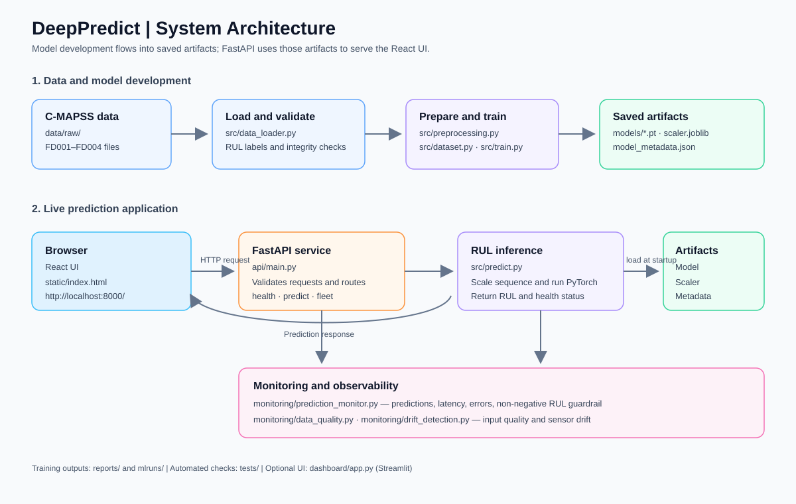

# DeepPredict Architecture

## Overview

DeepPredict estimates the remaining useful life (RUL) of turbofan engines using NASA C-MAPSS sensor data. The application combines a React-based browser UI, a FastAPI service, a PyTorch inference pipeline, and monitoring utilities. The current default dataset configuration is FD001.

## Architecture diagram

The diagram below shows how the training/data workflow creates model artifacts and how the running application uses them to serve predictions.



## Main components

### React UI

- `static/index.html` contains the browser UI and its React application.
- FastAPI serves the page at `/` and serves additional static assets from `/static`.
- The UI communicates with the same FastAPI service that hosts its files.

### API service

- `api/main.py` defines the FastAPI application and loads the predictor and data-quality monitor during application startup.
- `api/schemas.py` defines the request and response models.
- The service exposes health and model information, prediction, fleet exploration, and monitoring endpoints.
- The API loads the model once at startup and retains it for subsequent requests.

### Data and model pipeline

1. `src/data_loader.py` reads and validates the whitespace-delimited C-MAPSS files and prepares RUL labels.
2. `src/preprocessing.py` selects and scales sensor features.
3. `src/dataset.py` creates model-ready data, including sequence windows for deep learning.
4. `src/train.py` and `src/train_baseline.py` provide model training workflows; evaluation code and reports live under `src/` and `reports/`.
5. `src/predict.py` loads the saved PyTorch weights, scaler, and metadata, validates sensor sequences, and produces an RUL prediction.

The default model artifacts are `models/best_lstm_model.pt`, `models/scaler.joblib`, and `models/model_metadata.json`. The model configuration uses 30-cycle windows and 14 selected sensor features by default.

### Monitoring

- `monitoring/prediction_monitor.py` tracks prediction latency, outputs, errors, and optional labeled metrics. Negative predicted RUL is clipped to zero.
- `monitoring/data_quality.py` provides data-quality monitoring.
- `monitoring/drift_detection.py` compares sensor distributions using KS tests, PSI, and Wasserstein distance.

## API routes

| Route | Purpose |
|---|---|
| `GET /` | Serve the React UI |
| `GET /health` | Report API and model readiness |
| `GET /model-info` | Return loaded model metadata and metrics |
| `POST /predict` | Predict RUL for a supplied sensor sequence or readings |
| `GET /monitoring/status` | Return prediction monitoring statistics |
| `GET /api/monitoring/drift` | Return sensor drift information |
| `GET /api/engines` | List test-fleet engines |
| `GET /api/engines/{unit_id}` | Retrieve a test engine's trajectory and truth |
| `POST /api/engines/{unit_id}/predict` | Predict RUL for a test-fleet engine |

Interactive API documentation is available at `/docs` while the service is running.

## Project folder structure

```text
DeepPredict/
|
|-- api/                              FastAPI web service
|   |-- main.py                       API routes, startup, UI hosting
|   `-- schemas.py                    Validated API request/response shapes
|
|-- static/                           Browser frontend served by FastAPI
|   `-- index.html                    React UI and page styling
|
|-- src/                              Data science and ML application code
|   |-- config.py                     Shared paths and pipeline settings
|   |-- data_loader.py                Read, validate, and label C-MAPSS data
|   |-- preprocessing.py              Feature selection and scaling
|   |-- feature_engineering.py        Sensor/window feature transformations
|   |-- dataset.py                    Model-ready datasets and sequences
|   |-- models.py                     PyTorch model definitions
|   |-- train.py                      Deep-learning training workflow
|   |-- train_baseline.py             Baseline model training workflow
|   |-- predict.py                    Load artifacts and run RUL inference
|   |-- evaluate.py                   Baseline evaluation
|   |-- evaluate_lstm.py              LSTM evaluation
|   |-- metrics.py                    Regression and prognostics metrics
|   |-- explainability.py             Model interpretation utilities
|   |-- create_sample_request.py      Create example prediction input
|   `-- logging_config.py             Shared logging setup
|
|-- monitoring/                       Runtime observability and data checks
|   |-- prediction_monitor.py         Prediction, latency, and error tracking
|   |-- data_quality.py               Input data quality checks
|   `-- drift_detection.py            KS, PSI, and Wasserstein drift checks
|
|-- data/
|   |-- raw/                           Original C-MAPSS data and documentation
|   |   |-- train_FD001.txt ... FD004   Training engine histories
|   |   |-- test_FD001.txt ... FD004    Test engine histories
|   |   `-- RUL_FD001.txt ... FD004     Test-engine ground truth
|   `-- processed/                     Prepared/generated data (if produced)
|
|-- models/                            Model artifacts used at inference
|   |-- best_lstm_model.pt             Trained PyTorch weights
|   |-- scaler.joblib                  Fitted feature scaler
|   `-- model_metadata.json            Model type, features, and run metadata
|
|-- reports/
|   |-- sample_sequence.json           Example input for the prediction API
|   |-- evaluation/                    Saved evaluation summaries
|   `-- figures/                       Evaluation plots
|
|-- notebooks/                         Jupyter analysis and experiments
|   |-- 01_exploratory_data_analysis.ipynb
|   |-- 02_feature_engineering.ipynb
|   `-- 03_model_experiments.ipynb
|-- tests/                              Pytest coverage for API and ML utilities
|-- mlruns/                            Local MLflow tracking data
|-- architecture.md                    This architecture and folder guide
|-- architecture.svg                   Architecture diagram image
|-- changelog.md                       Project change notes
|-- README.md                          Project overview and usage guide
|-- .env.example                       Example environment configuration
|-- requirements.txt                   Python dependencies
|-- Dockerfile                         Container image definition
`-- docker-compose.yml                 FastAPI and React UI service
```

The tree lists key files rather than every package initializer or generated file. `.venv/`, when present, is a local Python virtual environment and is not application source code.

### How to read the structure

- **Start at `api/main.py`** to understand how browser requests reach the backend.
- **Start at `static/index.html`** to find the React UI. This project serves that UI through FastAPI; it does not have a separate React `package.json` build.
- **Start at `src/predict.py`** to follow a live model prediction. It uses preprocessing and the model artifacts in `models/`.
- **Start at `src/train.py`** to follow the LSTM training workflow. Training reads data through `src/data_loader.py` and saves artifacts and evaluation outputs.
- **Look in `monitoring/`** for runtime prediction health, input quality, and sensor drift.
- **Look in `tests/`** for automated checks of the data loader, preprocessing, metrics, and API.
- **Treat `data/raw/`, `models/`, `reports/`, and `mlruns/` as data or generated artifacts**, rather than Python application modules.

## Local startup

From the project root in Windows PowerShell, with dependencies installed in `.venv`:

```powershell
.\.venv\Scripts\python.exe -m uvicorn api.main:app --host 0.0.0.0 --port 8000
```

Open `http://localhost:8000/` for the React UI and `http://localhost:8000/docs` for the API documentation. The UI and API are local to the machine unless the service is deployed and exposed through an appropriate hosting/network configuration.

## Container configuration

`Dockerfile` defines the Python application image. `docker-compose.yml` runs the FastAPI service, which also serves the React UI at `/`. Docker requires a running Docker engine.
